# MGPL SQLite Schema

Generated on 2026-09-01 from `src/db.ts`.

## Mermaid ERD

```mermaid
erDiagram
  AuthUsers {
    TEXT id PK
    TEXT email
    TEXT passwordHash
    TEXT displayName
    TEXT avatarUrl
    TEXT gamerTag
    TEXT profileVisibility
    TEXT role
    DATETIME createdAt
    DATETIME updatedAt
  }
  AppDealsWishlist {
    INTEGER id PK
    TEXT steamAppId
    TEXT gameTitle
    REAL targetPrice
    DATETIME createdAt
  }
  AppPriceAlerts {
    INTEGER id PK
    TEXT userId
    TEXT gameId
    TEXT title
    REAL targetPrice
    REAL currentPrice
    REAL historicalLow
    INTEGER isTriggered
    INTEGER acknowledged
    DATETIME createdAt
    DATETIME updatedAt
  }
  InstalledMods {
    INTEGER id PK
    TEXT modId
    TEXT gameDomain
    TEXT modName
    TEXT version
    DATETIME installedAt
  }
  Mods {
    INTEGER id PK
    TEXT gameId
    TEXT modName
    TEXT author
    TEXT sourceDomain
    TEXT sourceUrl
    INTEGER downloads
    TEXT version
    INTEGER minVramGb
    INTEGER minRamGb
    INTEGER active_installs
    INTEGER rating_count
    TEXT version_tag
    TEXT author_handle
    TEXT description
    DATETIME createdAt
    DATETIME updatedAt
  }
  ModVersions {
    INTEGER id PK
    TEXT gameDomain
    TEXT modId
    TEXT version
    TEXT changelog
    TEXT releasedAt
    DATETIME createdAt
  }
  ModDependencies {
    INTEGER id PK
    TEXT gameDomain
    TEXT modId
    TEXT dependsOn
    INTEGER isHard
    TEXT filePaths
    DATETIME createdAt
  }
  ModLoadOrder {
    INTEGER id PK
    TEXT gameDomain
    TEXT modId
    INTEGER position
    INTEGER isActive
    DATETIME updatedAt
  }
  AppDealPriceHistory {
    INTEGER id PK
    TEXT gameId
    TEXT title
    TEXT store
    REAL price
    TEXT recordedAt
  }
  AppCompletionRoadmapCache {
    INTEGER id PK
    TEXT gameTitle
    REAL mainStory
    REAL mainExtra
    REAL completionist
    REAL hltbScore
    DATETIME cachedAt
  }
  AppGameTags {
    INTEGER id PK
    TEXT userId
    TEXT gameId
    TEXT tagName
    TEXT colorHex
    DATETIME createdAt
  }
  AppGameNotes {
    INTEGER id PK
    TEXT userId
    TEXT gameId
    TEXT noteMarkdown
    DATETIME updatedAt
  }
  AppWishlist {
    INTEGER id PK
    TEXT userId
    TEXT gameId
    TEXT title
    TEXT coverImage
    REAL targetPrice
    REAL currentBestPrice
    TEXT bestStore
    TEXT bestStoreType
    REAL historicalLow
    INTEGER isTriggered
    TEXT notes
    DATETIME createdAt
    DATETIME updatedAt
  }
  AppRetroTracking {
    INTEGER id PK
    TEXT gameTitle
    TEXT system
    TEXT status
    REAL playtimeHours
    INTEGER personalRating
    INTEGER isFavorite
    TEXT notes
    DATETIME createdAt
    DATETIME updatedAt
  }
  AppBacklog {
    INTEGER id PK
    TEXT gameId
    TEXT title
    TEXT status
    INTEGER priorityScore
    REAL hltbMainHours
    REAL hltbMainExtraHours
    REAL hltbCompletionistHours
    REAL etaDays
    DATETIME updatedAt
  }
  AppPlaySessions {
    INTEGER id PK
    TEXT sessionUuid
    TEXT gameId
    DATETIME startedAt
    DATETIME endedAt
    INTEGER durationSeconds
    TEXT deviceId
    INTEGER synced
    DATETIME createdAt
  }
  AuthAccounts {
    TEXT id PK
    TEXT userId
    TEXT provider
    TEXT providerAccountId
    TEXT tokenEnc
    TEXT tokenIv
    DATETIME createdAt
  }
  AppPlatformHandles {
    TEXT id PK
    TEXT userId
    TEXT steamUsername
    TEXT psnId
    TEXT xboxGamertag
    TEXT gogUsername
    TEXT epicUsername
    TEXT ubisoftUsername
    INTEGER hidePlatformIds
    DATETIME createdAt
    DATETIME updatedAt
  }
  AuthPlatformLinks {
    TEXT id PK
    TEXT userId
    TEXT platform
    TEXT publicId
    TEXT displayHandle
    TEXT tokenEnc
    TEXT tokenIv
    DATETIME connectedAt
    DATETIME lastSyncedAt
  }
  AppFriendships {
    TEXT id PK
    TEXT userId
    TEXT friendId
    TEXT status
    TEXT source
    DATETIME createdAt
    DATETIME updatedAt
  }
  AppTracking {
    TEXT GameID PK
    TEXT Play_Status
    TEXT Want_to_Play_
    INTEGER Personal_Rating__1_10_
    REAL Hours_Played
    TEXT Last_Played_Date
    TEXT Played_Platform
    TEXT Played_Hardware_Device
    TEXT Completed_Date
    TEXT Replay_Interest
    TEXT DLC_Status
    TEXT Personal_Review
    TEXT Notes
    TEXT targetTdp
    TEXT targetFps
    TEXT resolution
    TEXT cpuBoost
    TEXT tuningNotes
    TEXT playNotes
    TEXT achievementNotes
    TEXT tags
    INTEGER Trophy_Progress
    TEXT targetStyle
  }
  AppGames {
    TEXT GameID PK
    TEXT Game_Title
    TEXT Primary_Genre
    TEXT Storage_Size
    REAL Min_RAM_GB
    REAL Min_VRAM_GB
    TEXT SSD_Required_
    TEXT Active
    TEXT Nexus_Mods_URL
    TEXT cover_url
    TEXT nexusUrl
    INTEGER nexusModCount
    INTEGER trackedModCount
    TEXT platformStoreUrls
    TEXT storeUrl
    TEXT storefront
    REAL criticScore
    TEXT originalGameReleaseDate
    TEXT publisher
    TEXT headerImage
    TEXT Date_Added
    TEXT Last_Modified
  }
  Devices {
    TEXT deviceId PK
    TEXT deviceName
    TEXT formFactor
    TEXT gpuModel
    REAL vramGb
    TEXT cpuModel
    REAL ramGb
    TEXT motherboard
    TEXT caseModel
    TEXT psu
    REAL storageCapacityGb
    TEXT os
    REAL batteryWh
    INTEGER isArchived
    REAL tdpWatts
    DATETIME createdAt
    DATETIME updatedAt
  }
  AppDevices {
    TEXT id PK
    TEXT userId
    TEXT deviceName
    TEXT deviceType
    TEXT cpuModel
    INTEGER cpuCores
    REAL ramGb
    TEXT gpuModel
    REAL vramGb
    TEXT gpuType
    TEXT storageType
    REAL storageFreeGb
    INTEGER isPortable
    INTEGER isPrimary
    DATETIME createdAt
    DATETIME updatedAt
  }
  catalog_devices {
    TEXT id PK
    TEXT name
    TEXT brand
    TEXT type
    TEXT releaseDate
    REAL msrp
    TEXT imageUrl
    INTEGER isPrebuilt
    TEXT platformCanonical
  }
  catalog_device_specs {
    INTEGER specId PK
    TEXT deviceId
    TEXT cpuModel
    TEXT gpuModel
    REAL gpuVramGb
    REAL ramGb
    REAL storageGb
    REAL tdpWatts
    TEXT gpuTier
    TEXT cpuTier
  }
  AppOwnership {
    TEXT OwnershipID PK
    TEXT GameID
    TEXT Platform
    TEXT Store_URL
    TEXT Platform_Specific_Release_Date
    TEXT Platform_DLC_Search_URL
    TEXT Edition
    TEXT Format
    TEXT Ownership_Access_Type
    TEXT Purchase_Date
    REAL Price_Paid
    TEXT Currency
    TEXT Preferred_Platform_
  }
  platform_audit_logs {
    INTEGER id PK
    TEXT tableName
    TEXT rowId
    TEXT field
    TEXT oldValue
    TEXT newValue
    TEXT reason
    TEXT operator
    DATETIME createdAt
  }
  analytics_access_logs {
    INTEGER id PK
    TEXT userId
    TEXT role
    TEXT route
    TEXT method
    TEXT ip
    TEXT outcome
    TEXT reason
    DATETIME createdAt
  }
  device_components {
    TEXT componentId PK
    TEXT category
    TEXT brand
    TEXT model
    TEXT socketType
    TEXT ddrGen
    TEXT formFactor
    REAL tdpWatts
    REAL priceUsd
    TEXT imageUrl
  }
  device_builds {
    TEXT buildId PK
    TEXT userId
    TEXT buildName
    TEXT shareSlug
    TEXT componentsJson
    REAL totalPriceSnapshot
    INTEGER estimatedWattage
    DATETIME createdAt
  }
  compatibility_rules {
    TEXT ruleId PK
    TEXT categoryA
    TEXT fieldA
    TEXT operator
    TEXT categoryB
    TEXT fieldB
    TEXT severity
    TEXT messageTemplate
  }
  game_performance_profiles {
    TEXT profileId PK
    TEXT gameId
    TEXT gpuTier
    TEXT cpuTier
    REAL fps4kUltra
    REAL fps1440pHigh
    REAL fps1080pMed
    REAL fps720pLow
    TEXT dataSource
  }
  device_reviews {
    INTEGER reviewId PK
    TEXT deviceId
    TEXT userId
    INTEGER rating
    TEXT title
    TEXT body
    TEXT prosJson
    TEXT consJson
    INTEGER isEditorsPick
    INTEGER helpfulScore
    INTEGER isVerifiedOwner
    DATETIME createdAt
  }
  review_votes {
    INTEGER voteId PK
    INTEGER reviewId
    TEXT userId
    TEXT voteType
  }
  hardware_price_history {
    INTEGER priceId PK
    TEXT deviceId
    TEXT componentId
    TEXT retailer
    REAL priceUsd
    TEXT condition
    TEXT recordedAt
  }
  release_radar {
    TEXT releaseId PK
    TEXT title
    TEXT releaseDate
    TEXT platform
    TEXT publisher
    REAL priceUsd
    TEXT preorderUrl
    TEXT bannerUrl
    INTEGER isVerified
  }
  community_benchmarks {
    TEXT benchmarkId PK
    TEXT componentId
    TEXT componentType
    TEXT componentName
    TEXT resolution
    TEXT settingsPreset
    REAL avgFps
    REAL onePercentLowFps
    INTEGER sampleCount
    TEXT source
    TEXT recordedAt
  }
AuthUsers ||--o{ AppPriceAlerts : references
AppGames ||--o{ Mods : references
AuthUsers ||--o{ AppGameTags : references
AuthUsers ||--o{ AppGameNotes : references
AuthUsers ||--o{ AppWishlist : references
AuthUsers ||--o{ AuthAccounts : references
AuthUsers ||--o{ AppPlatformHandles : references
AuthUsers ||--o{ AuthPlatformLinks : references
AuthUsers ||--o{ AppFriendships : references
AuthUsers ||--o{ AppDevices : references
catalog_devices ||--o{ catalog_device_specs : references
AuthUsers ||--o{ device_builds : references
AppGames ||--o{ game_performance_profiles : references
catalog_devices ||--o{ device_reviews : references
AuthUsers ||--o{ device_reviews : references
device_reviews ||--o{ review_votes : references
AuthUsers ||--o{ review_votes : references
```

## Tables

### AuthUsers

| Column            | Type     | Nullable | PK  | Default |
| ----------------- | -------- | -------- | --- | ------- |
| id                | TEXT     | Yes      | Yes | No      |
| email             | TEXT     | Yes      | No  | No      |
| passwordHash      | TEXT     | Yes      | No  | No      |
| displayName       | TEXT     | Yes      | No  | No      |
| avatarUrl         | TEXT     | Yes      | No  | No      |
| gamerTag          | TEXT     | Yes      | No  | No      |
| profileVisibility | TEXT     | No       | No  | Yes     |
| role              | TEXT     | No       | No  | Yes     |
| createdAt         | DATETIME | No       | No  | Yes     |
| updatedAt         | DATETIME | No       | No  | Yes     |

### AppDealsWishlist

| Column      | Type     | Nullable | PK  | Default |
| ----------- | -------- | -------- | --- | ------- |
| id          | INTEGER  | Yes      | Yes | No      |
| steamAppId  | TEXT     | Yes      | No  | No      |
| gameTitle   | TEXT     | Yes      | No  | No      |
| targetPrice | REAL     | Yes      | No  | No      |
| createdAt   | DATETIME | Yes      | No  | Yes     |

### AppPriceAlerts

| Column        | Type     | Nullable | PK  | Default |
| ------------- | -------- | -------- | --- | ------- |
| id            | INTEGER  | Yes      | Yes | No      |
| userId        | TEXT     | No       | No  | No      |
| gameId        | TEXT     | No       | No  | No      |
| title         | TEXT     | No       | No  | No      |
| targetPrice   | REAL     | No       | No  | No      |
| currentPrice  | REAL     | Yes      | No  | No      |
| historicalLow | REAL     | Yes      | No  | No      |
| isTriggered   | INTEGER  | Yes      | No  | Yes     |
| acknowledged  | INTEGER  | Yes      | No  | Yes     |
| createdAt     | DATETIME | Yes      | No  | Yes     |
| updatedAt     | DATETIME | Yes      | No  | Yes     |

Foreign keys:

- (userId) -> AuthUsers(id) ON DELETE CASCADE

### InstalledMods

| Column      | Type     | Nullable | PK  | Default |
| ----------- | -------- | -------- | --- | ------- |
| id          | INTEGER  | Yes      | Yes | No      |
| modId       | TEXT     | No       | No  | No      |
| gameDomain  | TEXT     | No       | No  | No      |
| modName     | TEXT     | No       | No  | No      |
| version     | TEXT     | Yes      | No  | No      |
| installedAt | DATETIME | Yes      | No  | Yes     |

### Mods

| Column          | Type     | Nullable | PK  | Default |
| --------------- | -------- | -------- | --- | ------- |
| id              | INTEGER  | Yes      | Yes | No      |
| gameId          | TEXT     | No       | No  | No      |
| modName         | TEXT     | No       | No  | No      |
| author          | TEXT     | Yes      | No  | No      |
| sourceDomain    | TEXT     | No       | No  | No      |
| sourceUrl       | TEXT     | Yes      | No  | No      |
| downloads       | INTEGER  | Yes      | No  | Yes     |
| version         | TEXT     | Yes      | No  | No      |
| minVramGb       | INTEGER  | Yes      | No  | No      |
| minRamGb        | INTEGER  | Yes      | No  | No      |
| active_installs | INTEGER  | Yes      | No  | Yes     |
| rating_count    | INTEGER  | Yes      | No  | Yes     |
| version_tag     | TEXT     | Yes      | No  | No      |
| author_handle   | TEXT     | Yes      | No  | No      |
| description     | TEXT     | Yes      | No  | No      |
| createdAt       | DATETIME | Yes      | No  | Yes     |
| updatedAt       | DATETIME | Yes      | No  | Yes     |

Foreign keys:

- (gameId) -> AppGames(GameID)

### ModVersions

| Column     | Type     | Nullable | PK  | Default |
| ---------- | -------- | -------- | --- | ------- |
| id         | INTEGER  | Yes      | Yes | No      |
| gameDomain | TEXT     | No       | No  | No      |
| modId      | TEXT     | No       | No  | No      |
| version    | TEXT     | No       | No  | No      |
| changelog  | TEXT     | Yes      | No  | No      |
| releasedAt | TEXT     | Yes      | No  | No      |
| createdAt  | DATETIME | Yes      | No  | Yes     |

### ModDependencies

| Column     | Type     | Nullable | PK  | Default |
| ---------- | -------- | -------- | --- | ------- |
| id         | INTEGER  | Yes      | Yes | No      |
| gameDomain | TEXT     | No       | No  | No      |
| modId      | TEXT     | No       | No  | No      |
| dependsOn  | TEXT     | No       | No  | No      |
| isHard     | INTEGER  | No       | No  | Yes     |
| filePaths  | TEXT     | Yes      | No  | No      |
| createdAt  | DATETIME | Yes      | No  | Yes     |

### ModLoadOrder

| Column     | Type     | Nullable | PK  | Default |
| ---------- | -------- | -------- | --- | ------- |
| id         | INTEGER  | Yes      | Yes | No      |
| gameDomain | TEXT     | No       | No  | No      |
| modId      | TEXT     | No       | No  | No      |
| position   | INTEGER  | No       | No  | Yes     |
| isActive   | INTEGER  | No       | No  | Yes     |
| updatedAt  | DATETIME | Yes      | No  | Yes     |

### AppDealPriceHistory

| Column     | Type    | Nullable | PK  | Default |
| ---------- | ------- | -------- | --- | ------- |
| id         | INTEGER | Yes      | Yes | No      |
| gameId     | TEXT    | No       | No  | No      |
| title      | TEXT    | Yes      | No  | No      |
| store      | TEXT    | No       | No  | No      |
| price      | REAL    | No       | No  | No      |
| recordedAt | TEXT    | No       | No  | Yes     |

### AppCompletionRoadmapCache

| Column        | Type     | Nullable | PK  | Default |
| ------------- | -------- | -------- | --- | ------- |
| id            | INTEGER  | Yes      | Yes | No      |
| gameTitle     | TEXT     | Yes      | No  | No      |
| mainStory     | REAL     | Yes      | No  | No      |
| mainExtra     | REAL     | Yes      | No  | No      |
| completionist | REAL     | Yes      | No  | No      |
| hltbScore     | REAL     | Yes      | No  | No      |
| cachedAt      | DATETIME | Yes      | No  | Yes     |

### AppGameTags

| Column    | Type     | Nullable | PK  | Default |
| --------- | -------- | -------- | --- | ------- |
| id        | INTEGER  | Yes      | Yes | No      |
| userId    | TEXT     | No       | No  | No      |
| gameId    | TEXT     | No       | No  | No      |
| tagName   | TEXT     | No       | No  | No      |
| colorHex  | TEXT     | Yes      | No  | Yes     |
| createdAt | DATETIME | Yes      | No  | Yes     |

Foreign keys:

- (userId) -> AuthUsers(id) ON DELETE CASCADE

### AppGameNotes

| Column       | Type     | Nullable | PK  | Default |
| ------------ | -------- | -------- | --- | ------- |
| id           | INTEGER  | Yes      | Yes | No      |
| userId       | TEXT     | No       | No  | No      |
| gameId       | TEXT     | No       | No  | No      |
| noteMarkdown | TEXT     | No       | No  | No      |
| updatedAt    | DATETIME | Yes      | No  | Yes     |

Foreign keys:

- (userId) -> AuthUsers(id) ON DELETE CASCADE

### AppWishlist

| Column           | Type     | Nullable | PK  | Default |
| ---------------- | -------- | -------- | --- | ------- |
| id               | INTEGER  | Yes      | Yes | No      |
| userId           | TEXT     | No       | No  | No      |
| gameId           | TEXT     | No       | No  | No      |
| title            | TEXT     | No       | No  | No      |
| coverImage       | TEXT     | Yes      | No  | No      |
| targetPrice      | REAL     | No       | No  | No      |
| currentBestPrice | REAL     | Yes      | No  | No      |
| bestStore        | TEXT     | Yes      | No  | No      |
| bestStoreType    | TEXT     | Yes      | No  | No      |
| historicalLow    | REAL     | Yes      | No  | No      |
| isTriggered      | INTEGER  | Yes      | No  | Yes     |
| notes            | TEXT     | Yes      | No  | No      |
| createdAt        | DATETIME | Yes      | No  | Yes     |
| updatedAt        | DATETIME | Yes      | No  | Yes     |

Foreign keys:

- (userId) -> AuthUsers(id) ON DELETE CASCADE

### AppRetroTracking

| Column         | Type     | Nullable | PK  | Default |
| -------------- | -------- | -------- | --- | ------- |
| id             | INTEGER  | Yes      | Yes | No      |
| gameTitle      | TEXT     | No       | No  | No      |
| system         | TEXT     | Yes      | No  | No      |
| status         | TEXT     | Yes      | No  | No      |
| playtimeHours  | REAL     | Yes      | No  | No      |
| personalRating | INTEGER  | Yes      | No  | No      |
| isFavorite     | INTEGER  | Yes      | No  | Yes     |
| notes          | TEXT     | Yes      | No  | No      |
| createdAt      | DATETIME | Yes      | No  | Yes     |
| updatedAt      | DATETIME | Yes      | No  | Yes     |

### AppBacklog

| Column                 | Type     | Nullable | PK  | Default |
| ---------------------- | -------- | -------- | --- | ------- |
| id                     | INTEGER  | Yes      | Yes | No      |
| gameId                 | TEXT     | No       | No  | No      |
| title                  | TEXT     | No       | No  | No      |
| status                 | TEXT     | Yes      | No  | Yes     |
| priorityScore          | INTEGER  | Yes      | No  | Yes     |
| hltbMainHours          | REAL     | Yes      | No  | No      |
| hltbMainExtraHours     | REAL     | Yes      | No  | No      |
| hltbCompletionistHours | REAL     | Yes      | No  | No      |
| etaDays                | REAL     | Yes      | No  | No      |
| updatedAt              | DATETIME | Yes      | No  | Yes     |

### AppPlaySessions

| Column          | Type     | Nullable | PK  | Default |
| --------------- | -------- | -------- | --- | ------- |
| id              | INTEGER  | Yes      | Yes | No      |
| sessionUuid     | TEXT     | No       | No  | No      |
| gameId          | TEXT     | No       | No  | No      |
| startedAt       | DATETIME | Yes      | No  | No      |
| endedAt         | DATETIME | Yes      | No  | No      |
| durationSeconds | INTEGER  | No       | No  | Yes     |
| deviceId        | TEXT     | Yes      | No  | No      |
| synced          | INTEGER  | Yes      | No  | Yes     |
| createdAt       | DATETIME | Yes      | No  | Yes     |

### AuthAccounts

| Column            | Type     | Nullable | PK  | Default |
| ----------------- | -------- | -------- | --- | ------- |
| id                | TEXT     | Yes      | Yes | No      |
| userId            | TEXT     | No       | No  | No      |
| provider          | TEXT     | No       | No  | No      |
| providerAccountId | TEXT     | No       | No  | No      |
| tokenEnc          | TEXT     | Yes      | No  | No      |
| tokenIv           | TEXT     | Yes      | No  | No      |
| createdAt         | DATETIME | No       | No  | Yes     |

Foreign keys:

- (userId) -> AuthUsers(id) ON DELETE CASCADE

### AppPlatformHandles

| Column          | Type     | Nullable | PK  | Default |
| --------------- | -------- | -------- | --- | ------- |
| id              | TEXT     | Yes      | Yes | No      |
| userId          | TEXT     | No       | No  | No      |
| steamUsername   | TEXT     | Yes      | No  | No      |
| psnId           | TEXT     | Yes      | No  | No      |
| xboxGamertag    | TEXT     | Yes      | No  | No      |
| gogUsername     | TEXT     | Yes      | No  | No      |
| epicUsername    | TEXT     | Yes      | No  | No      |
| ubisoftUsername | TEXT     | Yes      | No  | No      |
| hidePlatformIds | INTEGER  | No       | No  | Yes     |
| createdAt       | DATETIME | No       | No  | Yes     |
| updatedAt       | DATETIME | No       | No  | Yes     |

Foreign keys:

- (userId) -> AuthUsers(id) ON DELETE CASCADE

### AuthPlatformLinks

| Column        | Type     | Nullable | PK  | Default |
| ------------- | -------- | -------- | --- | ------- |
| id            | TEXT     | Yes      | Yes | No      |
| userId        | TEXT     | No       | No  | No      |
| platform      | TEXT     | No       | No  | No      |
| publicId      | TEXT     | No       | No  | No      |
| displayHandle | TEXT     | Yes      | No  | No      |
| tokenEnc      | TEXT     | Yes      | No  | No      |
| tokenIv       | TEXT     | Yes      | No  | No      |
| connectedAt   | DATETIME | No       | No  | Yes     |
| lastSyncedAt  | DATETIME | Yes      | No  | No      |

Foreign keys:

- (userId) -> AuthUsers(id) ON DELETE CASCADE

### AppFriendships

| Column    | Type     | Nullable | PK  | Default |
| --------- | -------- | -------- | --- | ------- |
| id        | TEXT     | Yes      | Yes | No      |
| userId    | TEXT     | No       | No  | No      |
| friendId  | TEXT     | No       | No  | No      |
| status    | TEXT     | No       | No  | Yes     |
| source    | TEXT     | No       | No  | Yes     |
| createdAt | DATETIME | No       | No  | Yes     |
| updatedAt | DATETIME | No       | No  | Yes     |

Foreign keys:

- (userId) -> AuthUsers(id) ON DELETE CASCADE
- (friendId) -> AuthUsers(id) ON DELETE CASCADE

### AppTracking

| Column                 | Type    | Nullable | PK  | Default |
| ---------------------- | ------- | -------- | --- | ------- |
| GameID                 | TEXT    | Yes      | Yes | No      |
| Play Status            | TEXT    | Yes      | No  | Yes     |
| Want to Play?          | TEXT    | Yes      | No  | No      |
| Personal Rating (1-10) | INTEGER | Yes      | No  | No      |
| Hours Played           | REAL    | Yes      | No  | Yes     |
| Last Played Date       | TEXT    | Yes      | No  | No      |
| Played Platform        | TEXT    | Yes      | No  | No      |
| Played Hardware Device | TEXT    | Yes      | No  | No      |
| Completed Date         | TEXT    | Yes      | No  | No      |
| Replay Interest        | TEXT    | Yes      | No  | No      |
| DLC Status             | TEXT    | Yes      | No  | No      |
| Personal Review        | TEXT    | Yes      | No  | No      |
| Notes                  | TEXT    | Yes      | No  | No      |
| targetTdp              | TEXT    | Yes      | No  | No      |
| targetFps              | TEXT    | Yes      | No  | No      |
| resolution             | TEXT    | Yes      | No  | No      |
| cpuBoost               | TEXT    | Yes      | No  | No      |
| tuningNotes            | TEXT    | Yes      | No  | No      |
| playNotes              | TEXT    | Yes      | No  | No      |
| achievementNotes       | TEXT    | Yes      | No  | No      |
| tags                   | TEXT    | Yes      | No  | No      |
| Trophy Progress        | INTEGER | Yes      | No  | No      |
| targetStyle            | TEXT    | Yes      | No  | No      |

### AppGames

| Column                  | Type    | Nullable | PK  | Default |
| ----------------------- | ------- | -------- | --- | ------- |
| GameID                  | TEXT    | Yes      | Yes | No      |
| Game Title              | TEXT    | Yes      | No  | No      |
| Primary Genre           | TEXT    | Yes      | No  | No      |
| Storage Size            | TEXT    | Yes      | No  | No      |
| Min RAM GB              | REAL    | Yes      | No  | No      |
| Min VRAM GB             | REAL    | Yes      | No  | No      |
| SSD Required?           | TEXT    | Yes      | No  | No      |
| Active                  | TEXT    | Yes      | No  | No      |
| Nexus Mods URL          | TEXT    | Yes      | No  | No      |
| cover_url               | TEXT    | Yes      | No  | No      |
| nexusUrl                | TEXT    | Yes      | No  | No      |
| nexusModCount           | INTEGER | Yes      | No  | No      |
| trackedModCount         | INTEGER | Yes      | No  | No      |
| platformStoreUrls       | TEXT    | Yes      | No  | No      |
| storeUrl                | TEXT    | Yes      | No  | No      |
| storefront              | TEXT    | Yes      | No  | No      |
| criticScore             | REAL    | Yes      | No  | No      |
| originalGameReleaseDate | TEXT    | Yes      | No  | No      |
| publisher               | TEXT    | Yes      | No  | No      |
| headerImage             | TEXT    | Yes      | No  | No      |
| Date Added              | TEXT    | Yes      | No  | No      |
| Last Modified           | TEXT    | Yes      | No  | No      |

### Devices

| Column            | Type     | Nullable | PK  | Default |
| ----------------- | -------- | -------- | --- | ------- |
| deviceId          | TEXT     | Yes      | Yes | No      |
| deviceName        | TEXT     | Yes      | No  | No      |
| formFactor        | TEXT     | Yes      | No  | No      |
| gpuModel          | TEXT     | Yes      | No  | No      |
| vramGb            | REAL     | Yes      | No  | No      |
| cpuModel          | TEXT     | Yes      | No  | No      |
| ramGb             | REAL     | Yes      | No  | No      |
| motherboard       | TEXT     | Yes      | No  | No      |
| caseModel         | TEXT     | Yes      | No  | No      |
| psu               | TEXT     | Yes      | No  | No      |
| storageCapacityGb | REAL     | Yes      | No  | No      |
| os                | TEXT     | Yes      | No  | No      |
| batteryWh         | REAL     | Yes      | No  | No      |
| isArchived        | INTEGER  | Yes      | No  | Yes     |
| tdpWatts          | REAL     | Yes      | No  | No      |
| createdAt         | DATETIME | Yes      | No  | Yes     |
| updatedAt         | DATETIME | Yes      | No  | Yes     |

### AppDevices

| Column        | Type     | Nullable | PK  | Default |
| ------------- | -------- | -------- | --- | ------- |
| id            | TEXT     | Yes      | Yes | No      |
| userId        | TEXT     | No       | No  | No      |
| deviceName    | TEXT     | No       | No  | No      |
| deviceType    | TEXT     | No       | No  | No      |
| cpuModel      | TEXT     | Yes      | No  | No      |
| cpuCores      | INTEGER  | Yes      | No  | No      |
| ramGb         | REAL     | Yes      | No  | No      |
| gpuModel      | TEXT     | Yes      | No  | No      |
| vramGb        | REAL     | Yes      | No  | No      |
| gpuType       | TEXT     | Yes      | No  | No      |
| storageType   | TEXT     | Yes      | No  | No      |
| storageFreeGb | REAL     | Yes      | No  | No      |
| isPortable    | INTEGER  | Yes      | No  | Yes     |
| isPrimary     | INTEGER  | Yes      | No  | Yes     |
| createdAt     | DATETIME | No       | No  | Yes     |
| updatedAt     | DATETIME | No       | No  | Yes     |

Foreign keys:

- (userId) -> AuthUsers(id) ON DELETE CASCADE

### catalog_devices

| Column            | Type    | Nullable | PK  | Default |
| ----------------- | ------- | -------- | --- | ------- |
| id                | TEXT    | Yes      | Yes | No      |
| name              | TEXT    | No       | No  | No      |
| brand             | TEXT    | No       | No  | No      |
| type              | TEXT    | No       | No  | No      |
| releaseDate       | TEXT    | Yes      | No  | No      |
| msrp              | REAL    | Yes      | No  | No      |
| imageUrl          | TEXT    | Yes      | No  | No      |
| isPrebuilt        | INTEGER | Yes      | No  | Yes     |
| platformCanonical | TEXT    | Yes      | No  | No      |

### catalog_device_specs

| Column    | Type    | Nullable | PK  | Default |
| --------- | ------- | -------- | --- | ------- |
| specId    | INTEGER | Yes      | Yes | No      |
| deviceId  | TEXT    | No       | No  | No      |
| cpuModel  | TEXT    | Yes      | No  | No      |
| gpuModel  | TEXT    | Yes      | No  | No      |
| gpuVramGb | REAL    | Yes      | No  | No      |
| ramGb     | REAL    | Yes      | No  | No      |
| storageGb | REAL    | Yes      | No  | No      |
| tdpWatts  | REAL    | Yes      | No  | No      |
| gpuTier   | TEXT    | Yes      | No  | No      |
| cpuTier   | TEXT    | Yes      | No  | No      |

Foreign keys:

- (deviceId) -> catalog_devices(id) ON DELETE CASCADE

### AppOwnership

| Column                         | Type | Nullable | PK  | Default |
| ------------------------------ | ---- | -------- | --- | ------- |
| OwnershipID                    | TEXT | Yes      | Yes | No      |
| GameID                         | TEXT | Yes      | No  | No      |
| Platform                       | TEXT | Yes      | No  | No      |
| Store URL                      | TEXT | Yes      | No  | No      |
| Platform Specific Release Date | TEXT | Yes      | No  | No      |
| Platform DLC Search URL        | TEXT | Yes      | No  | No      |
| Edition                        | TEXT | Yes      | No  | No      |
| Format                         | TEXT | Yes      | No  | No      |
| Ownership Access Type          | TEXT | Yes      | No  | No      |
| Purchase Date                  | TEXT | Yes      | No  | No      |
| Price Paid                     | REAL | Yes      | No  | No      |
| Currency                       | TEXT | Yes      | No  | No      |
| Preferred Platform?            | TEXT | Yes      | No  | No      |

### platform_audit_logs

| Column    | Type     | Nullable | PK  | Default |
| --------- | -------- | -------- | --- | ------- |
| id        | INTEGER  | Yes      | Yes | No      |
| tableName | TEXT     | No       | No  | No      |
| rowId     | TEXT     | No       | No  | No      |
| field     | TEXT     | No       | No  | No      |
| oldValue  | TEXT     | Yes      | No  | No      |
| newValue  | TEXT     | Yes      | No  | No      |
| reason    | TEXT     | Yes      | No  | No      |
| operator  | TEXT     | Yes      | No  | No      |
| createdAt | DATETIME | No       | No  | Yes     |

### analytics_access_logs

| Column    | Type     | Nullable | PK  | Default |
| --------- | -------- | -------- | --- | ------- |
| id        | INTEGER  | Yes      | Yes | No      |
| userId    | TEXT     | Yes      | No  | No      |
| role      | TEXT     | Yes      | No  | No      |
| route     | TEXT     | No       | No  | No      |
| method    | TEXT     | No       | No  | No      |
| ip        | TEXT     | Yes      | No  | No      |
| outcome   | TEXT     | No       | No  | Yes     |
| reason    | TEXT     | Yes      | No  | No      |
| createdAt | DATETIME | No       | No  | Yes     |

### device_components

| Column      | Type | Nullable | PK  | Default |
| ----------- | ---- | -------- | --- | ------- |
| componentId | TEXT | Yes      | Yes | No      |
| category    | TEXT | No       | No  | No      |
| brand       | TEXT | No       | No  | No      |
| model       | TEXT | No       | No  | No      |
| socketType  | TEXT | Yes      | No  | No      |
| ddrGen      | TEXT | Yes      | No  | No      |
| formFactor  | TEXT | Yes      | No  | No      |
| tdpWatts    | REAL | Yes      | No  | No      |
| priceUsd    | REAL | No       | No  | No      |
| imageUrl    | TEXT | Yes      | No  | No      |

### device_builds

| Column             | Type     | Nullable | PK  | Default |
| ------------------ | -------- | -------- | --- | ------- |
| buildId            | TEXT     | Yes      | Yes | No      |
| userId             | TEXT     | No       | No  | No      |
| buildName          | TEXT     | No       | No  | No      |
| shareSlug          | TEXT     | No       | No  | No      |
| componentsJson     | TEXT     | No       | No  | No      |
| totalPriceSnapshot | REAL     | No       | No  | No      |
| estimatedWattage   | INTEGER  | No       | No  | No      |
| createdAt          | DATETIME | Yes      | No  | Yes     |

Foreign keys:

- (userId) -> AuthUsers(id) ON DELETE CASCADE

### compatibility_rules

| Column          | Type | Nullable | PK  | Default |
| --------------- | ---- | -------- | --- | ------- |
| ruleId          | TEXT | Yes      | Yes | No      |
| categoryA       | TEXT | No       | No  | No      |
| fieldA          | TEXT | No       | No  | No      |
| operator        | TEXT | No       | No  | No      |
| categoryB       | TEXT | Yes      | No  | No      |
| fieldB          | TEXT | Yes      | No  | No      |
| severity        | TEXT | No       | No  | No      |
| messageTemplate | TEXT | No       | No  | No      |

### game_performance_profiles

| Column       | Type | Nullable | PK  | Default |
| ------------ | ---- | -------- | --- | ------- |
| profileId    | TEXT | Yes      | Yes | No      |
| gameId       | TEXT | No       | No  | No      |
| gpuTier      | TEXT | No       | No  | No      |
| cpuTier      | TEXT | No       | No  | No      |
| fps4kUltra   | REAL | No       | No  | No      |
| fps1440pHigh | REAL | No       | No  | No      |
| fps1080pMed  | REAL | No       | No  | No      |
| fps720pLow   | REAL | No       | No  | No      |
| dataSource   | TEXT | No       | No  | Yes     |

Foreign keys:

- (gameId) -> AppGames(GameID) ON DELETE CASCADE

### device_reviews

| Column          | Type     | Nullable | PK  | Default |
| --------------- | -------- | -------- | --- | ------- |
| reviewId        | INTEGER  | Yes      | Yes | No      |
| deviceId        | TEXT     | No       | No  | No      |
| userId          | TEXT     | No       | No  | No      |
| rating          | INTEGER  | No       | No  | No      |
| title           | TEXT     | Yes      | No  | No      |
| body            | TEXT     | Yes      | No  | No      |
| prosJson        | TEXT     | Yes      | No  | No      |
| consJson        | TEXT     | Yes      | No  | No      |
| isEditorsPick   | INTEGER  | Yes      | No  | Yes     |
| helpfulScore    | INTEGER  | Yes      | No  | Yes     |
| isVerifiedOwner | INTEGER  | Yes      | No  | Yes     |
| createdAt       | DATETIME | No       | No  | Yes     |

Foreign keys:

- (deviceId) -> catalog_devices(id) ON DELETE CASCADE
- (userId) -> AuthUsers(id) ON DELETE CASCADE

### review_votes

| Column   | Type    | Nullable | PK  | Default |
| -------- | ------- | -------- | --- | ------- |
| voteId   | INTEGER | Yes      | Yes | No      |
| reviewId | INTEGER | No       | No  | No      |
| userId   | TEXT    | No       | No  | No      |
| voteType | TEXT    | No       | No  | No      |

Foreign keys:

- (reviewId) -> device_reviews(reviewId) ON DELETE CASCADE
- (userId) -> AuthUsers(id) ON DELETE CASCADE

### hardware_price_history

| Column      | Type    | Nullable | PK  | Default |
| ----------- | ------- | -------- | --- | ------- |
| priceId     | INTEGER | Yes      | Yes | No      |
| deviceId    | TEXT    | Yes      | No  | No      |
| componentId | TEXT    | Yes      | No  | No      |
| retailer    | TEXT    | Yes      | No  | No      |
| priceUsd    | REAL    | No       | No  | No      |
| condition   | TEXT    | Yes      | No  | No      |
| recordedAt  | TEXT    | Yes      | No  | No      |

### release_radar

| Column      | Type    | Nullable | PK  | Default |
| ----------- | ------- | -------- | --- | ------- |
| releaseId   | TEXT    | Yes      | Yes | No      |
| title       | TEXT    | No       | No  | No      |
| releaseDate | TEXT    | No       | No  | No      |
| platform    | TEXT    | No       | No  | No      |
| publisher   | TEXT    | Yes      | No  | No      |
| priceUsd    | REAL    | Yes      | No  | No      |
| preorderUrl | TEXT    | Yes      | No  | No      |
| bannerUrl   | TEXT    | Yes      | No  | No      |
| isVerified  | INTEGER | Yes      | No  | Yes     |

### community_benchmarks

| Column           | Type    | Nullable | PK  | Default |
| ---------------- | ------- | -------- | --- | ------- |
| benchmarkId      | TEXT    | Yes      | Yes | No      |
| componentId      | TEXT    | No       | No  | No      |
| componentType    | TEXT    | No       | No  | No      |
| componentName    | TEXT    | No       | No  | No      |
| resolution       | TEXT    | No       | No  | No      |
| settingsPreset   | TEXT    | No       | No  | No      |
| avgFps           | REAL    | No       | No  | No      |
| onePercentLowFps | REAL    | No       | No  | No      |
| sampleCount      | INTEGER | No       | No  | Yes     |
| source           | TEXT    | No       | No  | Yes     |
| recordedAt       | TEXT    | Yes      | No  | Yes     |
